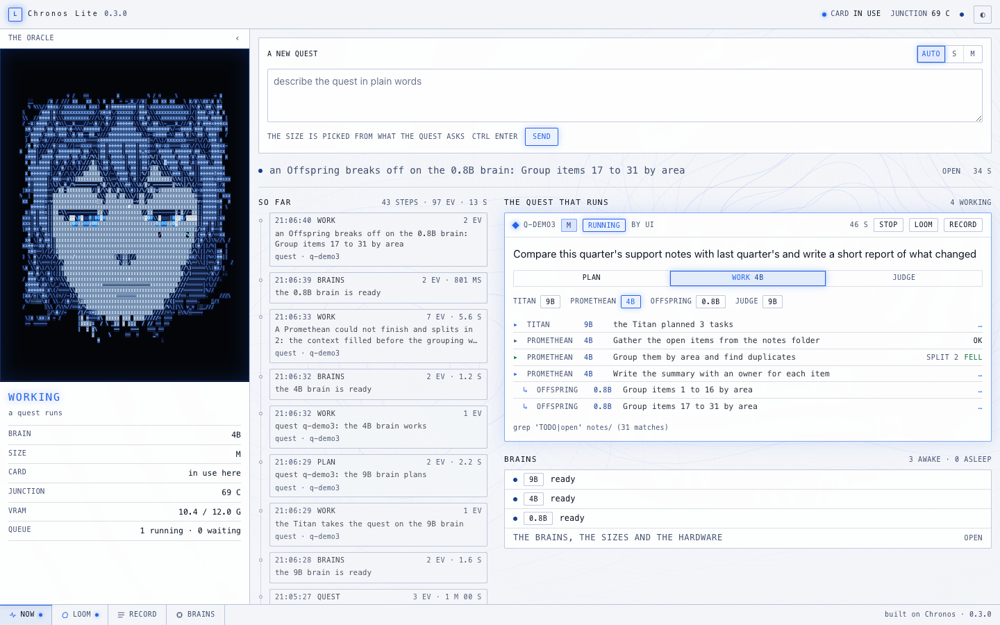
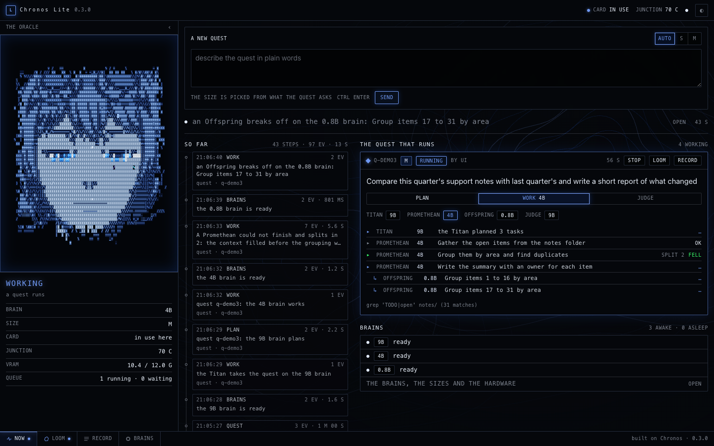
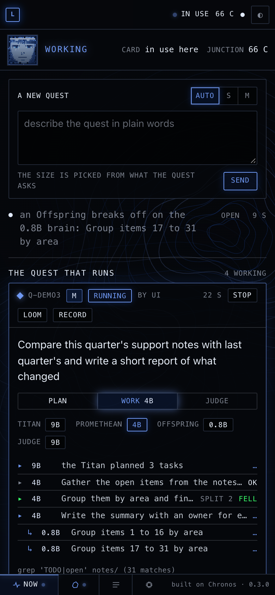
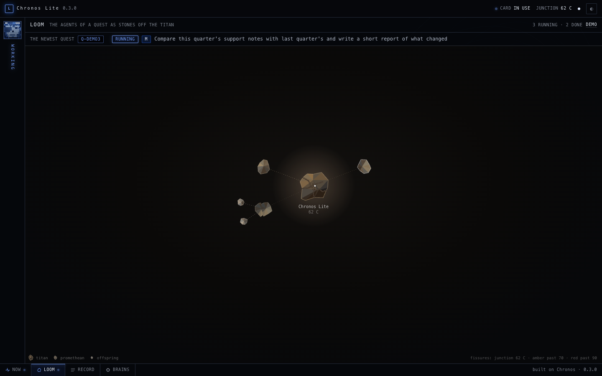
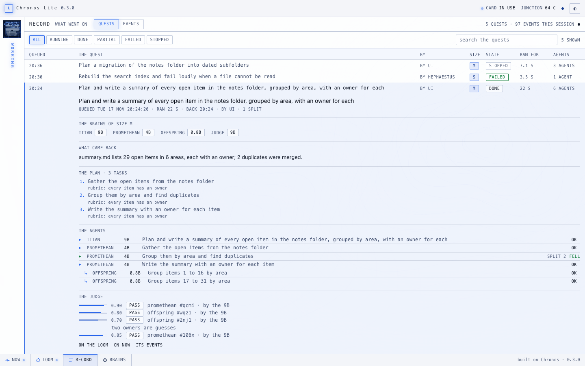
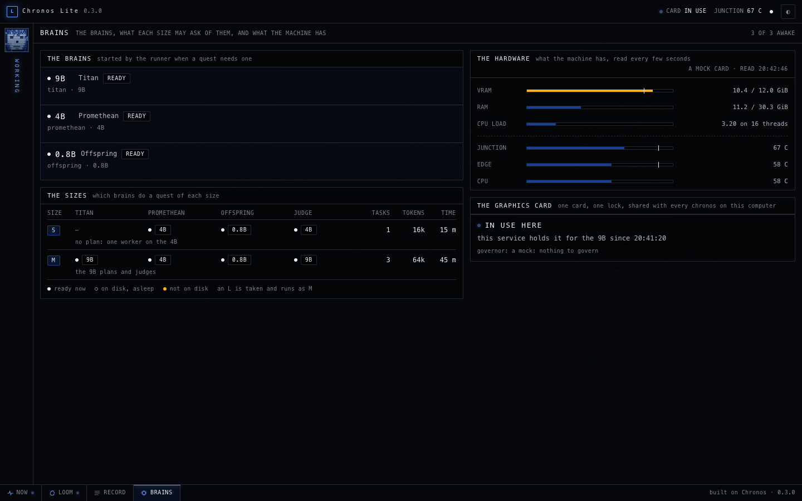
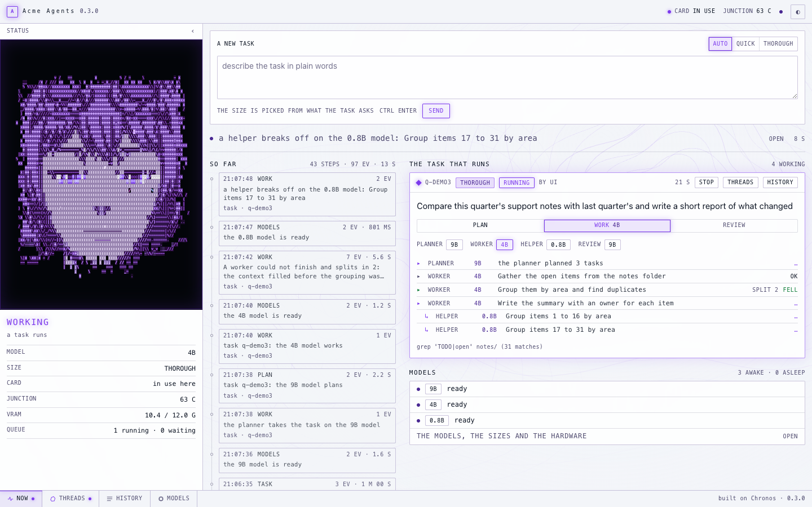
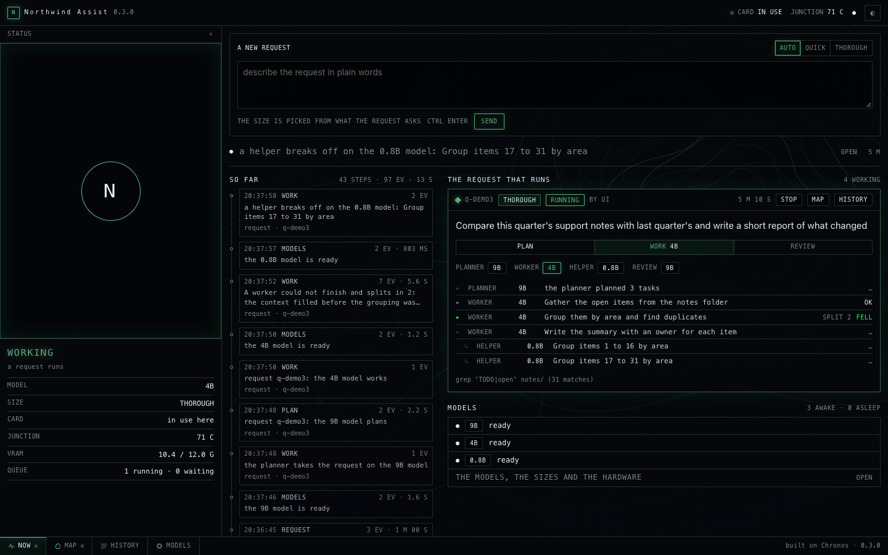

# Chronos Lite

**A smaller Chronos.** A local-models harness that takes a quest over HTTP, plans it on a 9B brain, works it on a 4B, splits a fall onto a 0.8B, judges the result and keeps a chained record, all on one computer's own card. White-label: a company's name on it, with a small "built on Chronos" mark kept.

"Lite" means smaller, not the light theme.

| | Chronos | Chronos Lite |
| --- | --- | --- |
| brains | six and five alternates | three: 0.8B, 4B, 9B |
| quest sizes | s, m, l | s, m (l runs as m) |
| routes | about 40 | 8 and the UI's files |
| interface | a full UI and a desktop app | Chronos's UI cut to four views and the face, white-label (no desktop app) |
| dependencies | none | none |

## What it looks like



It is Chronos's own UI, cut to what Lite serves. Chronos's face sits in the dock and reacts to the quests: she thinks while one is planned and judged, works while it runs, tears and re-forms on a split, flinches at a failure and says what came back. Four views sit along the bottom: Now (the ask, what is going on, the quest that runs), Loom (its agents as stones), Record (every quest and its report) and Models, called Brains in Chronos's words (the brains, the sizes, the hardware and the card).

Try it with no model at all: `npm run mock`, then open http://127.0.0.1:7779/ (`npm run mock -- --seed --cycle` starts with finished quests and sends a new one every 40 s, so the face goes through every state).

| Dark | Phone |
| --- | --- |
|  |  |

| Loom | Record | Models |
| --- | --- | --- |
|  |  |  |

### Any brand

| Acme, light | Northwind, dark |
| --- | --- |
|  |  |

A company's name, monogram or logo, accent, words and avatar (Chronos's face, tinted or not, or a monogram) go in [lite/brand.json](lite/brand.json); the page takes them on at load and keeps the small "built on Chronos" mark. The two samples are in [lite/brands](lite/brands), and [docs/ui.md](docs/ui.md) says how. These shots are of the mock service (`npm run mock -- --seed`), which plays scripted work and never touches a model.

## The caps

Held in [lite/edition.json](lite/edition.json) and checked by `npm test`: 3 brains, sizes s and m, 1 card, 25 brain turns a quest, a fall split at most 2 deep, 8 tools. Anything new replaces something or takes a slot.

## Install

Linux or macOS, Node 22 or later, `curl` and `tar`; no sudo, and nothing is written outside `~/.chronos-lite`.

```sh
sh scripts/install.sh --dry-run   # every action it would take; touches nothing
sh scripts/install.sh             # the engine and the three brains (--models minimal for the 0.8B alone, none for the engine only)
~/.chronos-lite/bin/chronos-lite start
chronos-lite ask "Count the stars" --size s
npm run doctor                    # node, engine, each brain and where it is, ports, card lock, GPU
```

When a full Chronos is installed on the same computer, its engine and brains are used in place, read-only, when they are the build and files `forge/brains.json` pins by sha256; only what is missing is downloaded, resumably, and checked the same way. Nothing in the full Chronos home is ever written, moved or deleted. Every option and the `chronos-lite` command (start, stop, status, doctor, ask) are in [docs/install.md](docs/install.md).

## Run it

Node 22 or later, no npm packages.

```sh
npm test                 # the edition check, then every runtime and script test
npm start                # the service on 127.0.0.1:7778
curl -s localhost:7778/health
npm run sync:check       # compare the carried files with a Chronos checkout (../chronos or CHRONOS_SRC)
```

It answers with no brains on disk; quests then end with the reason. A quest's tools work in `~/.chronos-lite/work` (`CHRONOS_LITE_WORKDIR`). Its home is `~/.chronos-lite` (`CHRONOS_LITE_HOME`), its port 7778 (`CHRONOS_LITE_PORT`), so it sits beside a full Chronos on 7777. The two share one card lock, so they never run on the GPU together.

## How a caller hires it

On this computer only (a POST from a web page that is not on localhost is refused). Every shape is in [docs/runtime-api.md](docs/runtime-api.md).

```
GET  /health              who this is, the brains, the sizes, the card lock, the queue
GET  /capabilities        what this edition can do
GET  /edition             the white label and the caps
POST /quests              {task, by?, size?, budget?} -> 202 {id, size, tier}; an idempotency-key header makes a retry answer the same quest
GET  /quests              the queue, newest first
GET  /quests/:id          its status and report
POST /quests/:id/stop     the workers halt between turns
GET  /events?since=n      what came after n, replayed from memory, then live (Server-Sent Events)
GET  /                    the UI's files, when ui/ is there
```

A Hephaestus hires it as a wisp: post the quest, follow the events, read the report. Its /health says kind `chronos` with edition `lite`, so the Chronos wisp driver hires it when pointed at port 7778. There are no envoys, no outbox and no ledger: a restart forgets.

## Layout

```
runtime/        the service, the runner, the workers, the brains, the model locator, the senses, the card lock
forge/          brains.json: the three brains and the two tiers
lite/           edition.json (the caps), brand.json (the white label), brands/ (two samples), carry.json (what came from Chronos)
ui/             the UI: app.js, brand.js (the white label), dock.js and face/ (the face), mood.js, store.js, views/ (now, loom, record, models)
scripts/        install.sh, doctor.mjs, chronos-lite.mjs (the command), check-edition.mjs (npm test), sync-check.mjs, mock-runtime.mjs
docs/           the plan, the runtime API, the decisions, the build map
```

## Licence

Apache 2.0. See [LICENSE](LICENSE). Chronos Lite is built on Chronos; the engine (llama.cpp) and the brains are separate works with their own licences and are downloaded, never bundled.
