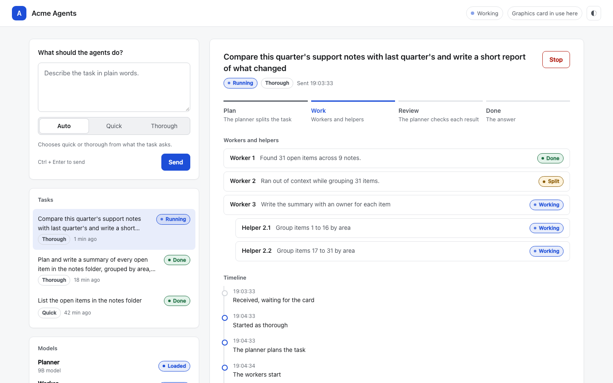

# The UI

One page, served by the service at `/` from `ui/`. Plain ES modules and CSS, no build step, no npm dependencies, no fonts or scripts from the network: it runs offline on localhost. It is written fresh for Lite and white-label from the start, so a company's name, mark, accent and words are the only identity it shows, with a small "built on Chronos" mark kept in the footer.



## What is on the page

The routes and events are the ones in [runtime-api.md](runtime-api.md).

- **Header.** The mark (the logo, or a monogram from `shortName`), the name, a health pill (Ready, Working, Reconnecting, Not answering) and the state of the graphics card from `/health` (free, in use here, busy elsewhere). A button switches the colour mode: the system's, light or dark; the choice is kept in the browser.
- **The ask.** A text box, the effort choice (Auto, Quick, Thorough) with a line on what each does, and Send (or Ctrl+Enter).
- **The list.** Every task, newest first, with its state and size. `GET /quests` seeds it; the event stream keeps it live.
- **The task being followed.** Its state, size and Stop; a strip of Plan, Work, Review, Done (Plan is marked not needed for a quick task); the workers and helpers, a helper nested under the step it took over after a split; the result; and the timeline, live from `/events`, with the runtime's detailed log behind a toggle.
- **Models.** Each model by its role and size (Planner, 9B model) and whether it is loaded, loading, idle, waiting for the card, failed or not installed.
- **Footer.** The built-on mark and the version.

Designed states: loading (skeleton rows), empty (no tasks yet), a task that cannot be found, the service not answering (a banner, Send disabled, retried every few seconds), the live feed dropped (a banner while it reconnects) and no models installed.

## Files

| file | what it does |
| --- | --- |
| `ui/index.html` | the shell: header, ask, list, models, detail, footer |
| `ui/app.css` | the look: neutral greys, one accent, light and dark, 390 px to wide |
| `ui/app.js` | boots, renders from state, sends, stops, follows the hash `#/t/<id>` |
| `ui/quests.js` | builds each task's steps and timeline from the events, in the page's words |
| `ui/brand.js` | turns `/edition` into the name, mark, accent and words |
| `ui/api.js` | the routes, and the event stream that reconnects with `?since=` |
| `scripts/mock-runtime.mjs` | a stand-in service for building and checking the UI |

## What it reads from the service

| route | used for |
| --- | --- |
| `GET /edition` | `{name, shortName, accent, logo, builtOn, version, caps}`, and `words` when the service passes it; falls back to `/health`'s name when absent |
| `GET /health` | health every 5 s (3 s while down): `brains` (a model's part comes from the `sizes` tiers, since the 9B's own role reads `talk`), `card {lock, mine}`, `sizes`, `hardware` |
| `GET /quests` | `{quests, counts}` once at start and after every reconnect; a bare array is taken too |
| `GET /quests/:id` | a task whose start fell out of the event ring, and the report when one finishes |
| `POST /quests` | `{task, size: "auto" \| "s" \| "m", by: "ui"}` |
| `POST /quests/:id/stop` | Stop |
| `GET /events?since=n` | everything live; after a drop it waits 1 s (doubling to 15 s) and reopens with the last `n` it saw |

Events it understands: `quest.queued`, `quest.started`, `quest.running` (with `downgraded`), `quest.phase`, `quest.done`, `agent.spawned`, `agent.split`, `agent.done`, `log` (a review when it carries `judge` and `score`), and `brain.loading|ready|stopped|failed|waiting`. Anything else is ignored.

## The words it shows

The runtime's inner names never reach the page. Log lines and summaries are rewritten on the way in, model ids become a size, and the service's own name becomes the brand's.

| inside the runtime | on the page |
| --- | --- |
| titan | planner |
| promethean | worker |
| offspring | helper |
| judge phase | review |
| size s | Quick |
| size m | Thorough |
| size auto | Auto |
| brain, `qwen3.5-9b` | model, 9B model |
| quest | task |
| Chronos (in runtime text) | the brand's name |

## How to rebrand

Set these in `lite/brand.json` (the installer does it, never a user); the service hands them to the page in `GET /edition`:

| field | what changes |
| --- | --- |
| `name` | the header, the tab title, and the service's name wherever runtime text says it |
| `shortName` | the monogram: the initials of two words ("Acme Corp" gives AC), else the first letter |
| `accent` | a CSS colour (`#1d4ed8`, `#15f`, `rgb(29 78 216)`, `teal`); it becomes the accent in light and in dark. One the browser cannot read is ignored and the default teal `#0f766e` holds |
| `logo` | an image in the mark instead of the monogram: a `data:image/...` URI or a path the service serves (`/brand/logo.svg`). Remote addresses are ignored, so the page never reaches the network |
| `builtOn` | the footer mark; keep it ("built on Chronos") |
| `words` | optional: any of `task`, `tasks`, `step`, `planner`, `worker`, `helper`, `review`, `model`, `models`, `auto`, `quick`, `thorough`, `agents`. `docs/runtime-api.md` does not list it on `/edition` yet: the page reads it when the service passes it from `lite/brand.json`, and the mock does |

The accent is used as given unless that would fail WCAG AA: brand.js moves it darker on light surfaces or lighter on dark ones, only as far as needed, so text on the accent stays at 4.5:1 or more and accent text on the page stays readable. A pale yellow brand gets a deeper yellow in light mode and stays as it is in dark.

Two brands as they look:

```json
{ "name": "Acme Agents", "shortName": "Acme", "accent": "#1d4ed8", "logo": null, "builtOn": "built on Chronos" }
```

```json
{ "name": "Northwind Assist", "shortName": "Northwind", "accent": "#15803d", "logo": null, "builtOn": "built on Chronos",
  "words": { "task": "request", "tasks": "Requests", "agents": "assistants" } }
```

| | light | dark |
| --- | --- | --- |
| Acme, 1440 | [acme-light-1440](media/ui/acme-light-1440.png) | [acme-dark-1440](media/ui/acme-dark-1440.png) |
| Acme, 390 | [detail](media/ui/acme-light-390.png), [list](media/ui/acme-light-390-list.png) | [acme-dark-390](media/ui/acme-dark-390.png) |
| Northwind, 1440 | [northwind-light-1440](media/ui/northwind-light-1440.png) | [northwind-dark-1440](media/ui/northwind-dark-1440.png) |
| Northwind, 390 | [detail](media/ui/northwind-light-390.png), [list](media/ui/northwind-light-390-list.png) | [northwind-dark-390](media/ui/northwind-dark-390.png) |
| service down | [acme-light-1440-down](media/ui/acme-light-1440-down.png) | |

## The mock

`scripts/mock-runtime.mjs` serves `ui/` and fakes the routes on 127.0.0.1:7779 (the real service is 7778), with no card and no model. ```sh
npm run mock                                                    # http://127.0.0.1:7779
node scripts/mock-runtime.mjs                                   # the same
node scripts/mock-runtime.mjs --brand path/to/brand.json        # another brand
node scripts/mock-runtime.mjs --name "Acme Agents" --short Acme --accent "#1d4ed8"
node scripts/mock-runtime.mjs --seed --hold 600 --speed 4       # two finished tasks and one held mid-work
```

- A quick task runs one worker. A thorough one plans three steps; the second worker cannot finish and its step is split between two helpers; the planner reviews each result. Auto picks thorough for long asks or words such as plan, compare, research, report.
- The first live thorough task drops every event stream once, mid-way, so the reconnect with `?since=` is exercised (`--no-drop` turns that off).
- `--seed` adds `q-demo1` (quick, done), `q-demo2` (thorough, done, with the split) and `q-demo3` (thorough, held just after its split for `--hold` seconds): open `#/t/q-demo3` for the screenshots.
- Test hooks: `POST /__mock/drop` ends every event stream; `POST /__mock/down?seconds=10` answers 503 on every service route for that long while the page stays served.
- `--speed 4` runs the script four times faster.

## Accessibility

Contrast at WCAG AA in both modes with any accent, a visible focus ring on everything that takes focus, every control reachable and usable by keyboard (Escape goes back to the list), states said in words as well as colour, a skip link, live regions for health and the timeline, and no motion when the system asks for reduced motion. An axe pass (WCAG 2.2 AA and best practice) on the seeded page finds nothing serious; keyboard order was checked by hand.
