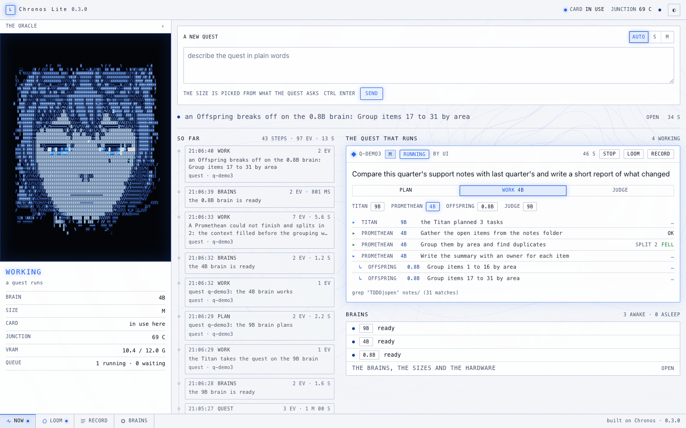
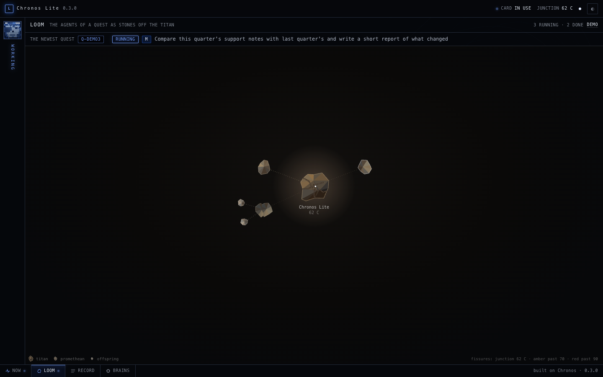
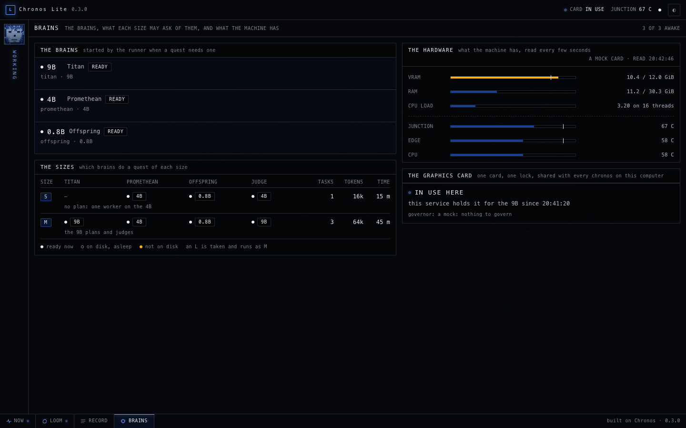
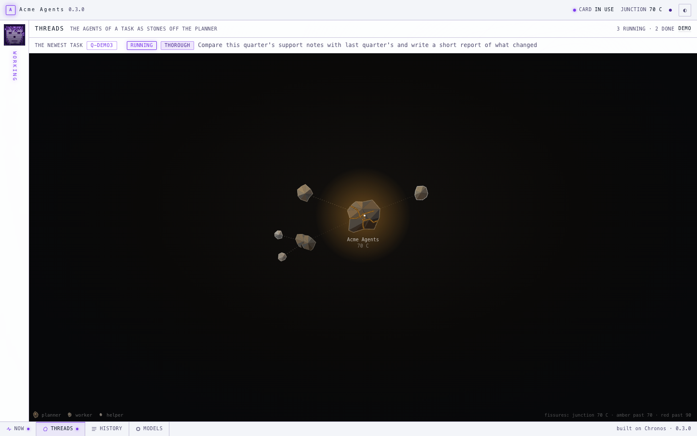
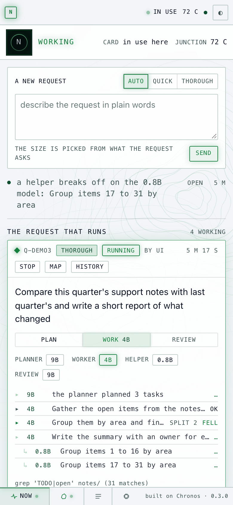

# The UI

Served by the service at `/` from `ui/`. Plain ES modules and CSS, no build step, no npm dependencies, no fonts or scripts from the network: it runs offline on localhost.

It is Chronos's own UI, carried over and cut to what Lite serves: Chronos's face in a dock on the left, and four views picked from a bar along the bottom. It is white-label: a company's name, mark, accent, words and avatar are the only identity it shows, with a small "built on Chronos" mark kept at the right end of the bar.



## What is on the page

The routes and events are the ones in [runtime-api.md](runtime-api.md).

- **The header.** The mark (the logo, or a monogram from `shortName`), the name and version, the card lock (free, in use, busy elsewhere; a stale lock reads free), the junction temperature, and a button for the colour mode (the system's, light or dark, kept in the browser).
- **The dock.** The face, the state word under it (idle, listening, thinking, speaking, working, held, done, sleep) and a readout: the brain at work, the size, the card, the junction, the VRAM and the queue. It folds to a 44 px avatar in the views that need the room, and is a strip across the top on a phone.
- **The views.** Now, Loom, Record and Models, along the bottom bar. A cell shows a live dot while something happens in its view. Alt+Shift+1 to 4 picks one. The hash keeps where you are: `#/<view>`, or `#/<view>/q:<quest id>` for one quest.
- **The backdrop.** Faint contour rings in the accent behind everything. Drawn once; nothing moves.

## The face

She is drawn live as a grid of monospace glyphs on one canvas, from eight frames in `ui/face/frames`. Her state comes from what stands now, not from single events, so a reload in the middle of a quest shows the right face (`ui/mood.js`):

| state | when |
| --- | --- |
| held | a heat cutoff or a throttle hold stands, a brain waits for the card another service holds, or something just failed |
| speaking | she says what a quest came back with |
| thinking | the quest that runs is planning or judging |
| working | a quest runs |
| listening | someone is typing an ask |
| done | a quest just landed |
| sleep | nothing happened for ten minutes |
| idle | otherwise |

On top of the state she reacts once: she tears and re-forms on a split, a failure hits her hard, a stop jolts her. When the system asks for reduced motion, nothing of her own moves; a change of state cross-fades.

## The views

- **Now.** The ask (the text, the size: auto, S or M, and send), a line that says the latest event in words, the steps so far on the left (newest on top), and on the right what stands now: a heat hold, the quest that runs (plan, work and judge, its brains, its agents with the helpers a split made nested under the step they took over, stop), the brains awake or loading, and the quests that wait.
- **Loom.** The agents of one quest as stones on a dark canvas: the Titan is one boulder, each Promethean a stone that breaks off it, each Offspring a pebble off its parent. The boulder's seams glow with the junction heat. It shows the quest the hash names, else the newest, and a demo link plays a scripted quest.
- **Record.** Every quest the service knows, newest first, filtered by state and by words; each opens on its report: what came back, the plan, the agents, the judging. A second tab lists this session's events.
- **Models** (Brains in Chronos's words). The three brains and their status, which brain plans, works, helps and judges at each size, the hardware as meters (VRAM, RAM, CPU load, temperatures) and who holds the card.

| Loom | Record | Models |
| --- | --- | --- |
|  |  |  |

## Files

| file | what it does |
| --- | --- |
| `ui/index.html` | the shell: header, stage (backdrop, dock, view), the bar |
| `ui/style.css` | the look: the tokens, light and dark, the header, the dock, the bar, 390 px to wide |
| `ui/views.css` | the four views |
| `ui/app.js` | boots, reads the brand, routes the hash to a view, mounts each view the first time it is shown |
| `ui/brand.js` | turns `/edition` into the name, mark, accent, words and avatar; keeps the accent readable |
| `ui/api.js` | the routes, and the event stream that reconnects with `?since=` |
| `ui/store.js` | the one store: the events and what they add up to (hardware, brains, quests, the log) |
| `ui/dock.js` | the dock: the face or the monogram, the state word, the readout |
| `ui/mood.js` | the face's state and her one-off reactions, worked out from the store |
| `ui/face/face.js`, `ui/face/frames/` | the face, drawn as glyphs from eight frames |
| `ui/viewbar.js` | the bar along the bottom and its keys |
| `ui/backdrop.js` | the contour rings behind the stage |
| `ui/loom.js` | the Loom's canvas: the stones, the heat, the demo |
| `ui/views/now.js`, `loom.js`, `record.js`, `models.js` | the four views |
| `ui/lib/` | the DOM helper, Markdown, shared parts, times, and events in words |
| `scripts/mock-runtime.mjs` | a stand-in service for building and checking the UI |
| `scripts/ui.test.mjs` | the brand, the words, the face's states and the mock, tested without a browser |

## What it reads from the service

| route | used for |
| --- | --- |
| `GET /edition` | the brand: `{name, shortName, accent, logo, builtOn, version, caps, vocabulary, words, avatar}`; falls back to `/health`'s name when absent |
| `GET /health` | every 5 s: the brains, the card lock, the sizes, the hardware |
| `GET /quests` | once at start and after every reconnect |
| `GET /quests/:id` | a quest whose start fell out of the event ring, and the report when one finishes |
| `POST /quests` | `{task, size: "auto" \| "s" \| "m", by: "ui"}` |
| `POST /quests/:id/stop` | Stop |
| `GET /events?since=n` | everything live; after a drop it reopens with the last `n` it saw |

## The words it shows

A brand picks a `vocabulary`. The shipped brand says `chronos`: Chronos's own words. A company's brand gets `plain` unless it asks, so the runtime's inner names never reach its page by accident. `words` renames any one of them on top.

| key | chronos | plain |
| --- | --- | --- |
| task, tasks | quest, quests | task, tasks |
| step | task | step |
| planner | titan | planner |
| worker | promethean | worker |
| helper | offspring | helper |
| review | judge | review |
| model, models | brain, brains | model, models |
| quick, thorough | s, m | quick, thorough |
| loom | loom | threads |
| record | record | history |
| oracle (the dock's title) | the oracle | status |

Model ids become a size (`qwen3.5-9b` is the 9B), and in a rebrand the service's own name in runtime text becomes the brand's.

## How to rebrand

Set these in `lite/brand.json` (the installer does it, never a user); the service hands them to the page in `GET /edition`:

| field | what changes |
| --- | --- |
| `name` | the header, the tab title, the Loom's boulder, and the service's name wherever runtime text says it |
| `shortName` | the monogram: the initials of two words ("Acme Corp" gives AC), else the first letter |
| `accent` | a CSS colour; it becomes the accent in light and in dark. `null` keeps Chronos's blue `#2563eb` |
| `logo` | an image in the mark instead of the monogram: a `data:image/...` URI or a path the service serves. Remote addresses are ignored, so the page never reaches the network |
| `builtOn` | the mark at the end of the bar; keep it ("built on Chronos") |
| `vocabulary` | `chronos` or `plain` (the table above); left out, `plain` |
| `words` | optional: any key of the table, renamed |
| `avatar` | `{ "kind": "face", "frames": null, "tint": null }` for Chronos's face (`frames` a local folder with the same eight file names, `tint` `"accent"` or a colour turns her blues and leaves her greys), or `{ "kind": "monogram" }` for the logo or monogram on the dark stage, the state on a ring around it |

The accent is used as given unless that would fail WCAG AA: `brand.js` moves it darker on light surfaces or lighter on dark ones, only as far as needed.

Two sample brands are in `lite/brands/`:

- `acme.json`: Acme Agents, a violet accent, plain words, Chronos's face tinted to the accent.
- `northwind.json`: Northwind Assist, a green accent, plain words with task as request and the Loom as map, and a monogram in place of the face.

| Acme, Loom | Northwind, phone |
| --- | --- |
|  |  |

The README shows Acme on the Now view in light and Northwind in dark.

## The mock

`scripts/mock-runtime.mjs` serves `ui/` and fakes the routes on 127.0.0.1:7779 (the real service is 7778), with no card and no model.

```sh
npm run mock                                                       # http://127.0.0.1:7779
node scripts/mock-runtime.mjs --brand lite/brands/acme.json        # another brand
node scripts/mock-runtime.mjs --name "Acme Agents" --short Acme --accent "#1d4ed8"
node scripts/mock-runtime.mjs --seed --hold 600                    # finished quests and one held mid-work
node scripts/mock-runtime.mjs --cycle                              # a new quest every 40 s: every state of the face
```

- A size S quest runs one Promethean. A size M one is planned in three tasks; the second Promethean falls and its task is split between two Offspring; the Titan judges each result. A quest with the word "fail" in it fails.
- The first live M quest drops every event stream once, mid-way, so the reconnect with `?since=` is exercised (`--no-drop` turns that off).
- `--seed` adds finished quests, one failed, one stopped, and `q-demo3`, an M quest held just after its split for `--hold` seconds: the screenshots are of it.
- Test hooks: `POST /__mock/drop` ends every event stream; `POST /__mock/down?seconds=10` answers 503 on every service route; `POST /__mock/heat?seconds=10` holds a heat cutoff.
- `--speed 4` runs the script four times faster.

The screenshots in `docs/media` are of the mock in headless Chromium at 1440 by 900 (the phone at 390 by 844), with reduced motion on so the face holds still.

## Accessibility

A skip link to the view, a visible focus ring on everything that takes focus, the views reachable by keyboard (Alt+Shift+1 to 4), states said in words as well as colour, a live region for the face's state, the accent kept at WCAG AA in both modes, and no motion of the face when the system asks for reduced motion.
